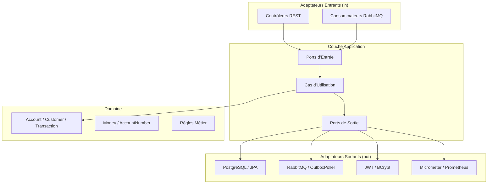

# NexBank — Plateforme Bancaire Numérique

> **Projet Éducatif — Ne gère pas d'argent réel**

<p align="center">
  <a href="README.md">🇺🇸 English</a> ·
  <a href="README.pt.md">🇧🇷 Português</a> ·
  <a href="README.fr.md">🇫🇷 Français</a>
</p>

---

<p align="center">

[](https://openjdk.org/projects/jdk/21/)
[](https://spring.io/projects/spring-boot)
[](https://angular.io/)
[](https://www.typescriptlang.org/)
[](https://www.postgresql.org/)
[](https://www.rabbitmq.com/)
[](https://docs.docker.com/compose/)
[](https://maven.apache.org/)
[](https://jwt.io/)
[](https://prometheus.io/)
[](https://flywaydb.org/)
[](https://www.jacoco.org/)
[](https://testcontainers.com/)
[](https://opensource.org/licenses/MIT)
[](https://github.com/leo12wb/Fintech-Api-Profissional/actions)

</p>

Plateforme fintech full-stack construite avec **Java 21 + Spring Boot 3**, **Angular 18**, **PostgreSQL 16**, **RabbitMQ** et **Docker Compose** — démontrant des patterns de niveau production : Architecture Hexagonale, JWT (RS256), Transactional Outbox, clés d'idempotence, métriques Micrometer et tests d'intégration avec Testcontainers.

---

## Fonctionnalités

- Inscription des clients et authentification JWT (RS256)
- Création et gestion de comptes (multi-devises)
- Dépôts et transferts entre comptes avec garanties d'idempotence
- Verrouillage optimiste sur les mises à jour de solde (`@Version`)
- Patron Transactional Outbox — publication fiable d'événements vers RabbitMQ
- Consommateurs d'événements de notification (TransactionCompleted, AccountCreated)
- Métriques Prometheus personnalisées (`nexbank_transactions_total`, `nexbank_transaction_amount_cents`)
- Indicateur de santé personnalisé pour la file outbox (`/actuator/health/outbox`)
- Migrations de base de données avec Flyway
- Documentation OpenAPI / Swagger complète
- Frontend Angular 18 avec Angular Material (lazy loading, guards, interceptors)
- Panneau d'administration avec mise en page séparée, tableau de bord et gestion des clients

## Stack Technique

| Couche | Technologie |
|---|---|
| Backend | Java 21, Spring Boot 3.3.5, Maven |
| Frontend | Angular 18.2, TypeScript strict, Angular Material 18.2 |
| Base de données | PostgreSQL 16, Flyway, JPA / Hibernate |
| Messagerie | RabbitMQ 3.13, Spring AMQP |
| Sécurité | Spring Security, OAuth2 Resource Server, JWT RS256 |
| Observabilité | Micrometer, Prometheus, Spring Actuator |
| Documentation API | SpringDoc OpenAPI (Swagger UI) |
| Tests | JUnit 5, Mockito, Testcontainers, ArchUnit, JaCoCo |
| Conteneurisation | Docker, Docker Compose |
| CI | GitHub Actions |

## Architecture

Le backend suit l'**Architecture Hexagonale (Ports et Adaptateurs)**, validée à la compilation par ArchUnit :

```
com.nexbank/
├── domain/            # Logique métier pure — sans Spring/JPA
│   ├── account/       #   Account, AccountNumber, Money, Currency
│   ├── customer/      #   Customer, enums
│   ├── transaction/   #   FinancialTransaction, enums
│   └── shared/        #   Money (value object), exceptions
├── application/       # Cas d'utilisation + interfaces de ports
│   ├── account/       #   OpenAccount, GetAccount
│   ├── transaction/   #   Deposit, Transfer, GetStatement
│   ├── customer/      #   RegisterCustomer, GetCustomer
│   ├── authentication/#   Port TokenService
│   └── shared/        #   OutboxEventRepository, MetricsPort
└── adapters/
    ├── in/
    │   ├── web/       #   Contrôleurs REST, DTOs, filtres, gestionnaire d'exceptions
    │   └── messaging/ #   Consommateurs RabbitMQ (NotificationConsumer)
    └── out/
        ├── persistence/  #  Entités JPA, dépôts, mappers MapStruct
        ├── messaging/    #  OutboxPoller (@Scheduled)
        ├── security/     #  JwtTokenService, BcryptPasswordEncoderAdapter
        ├── metrics/      #  MicrometerMetricsAdapter
        └── configuration/#  SecurityConfig, RabbitMqConfig, AppProperties, ...
```

### Diagramme d'Architecture



### Flux Transactional Outbox

```
Requête HTTP → Cas d'utilisation → save(Transaction) + save(OutboxEvent[PENDING])  ← même tx DB
                                                        ↓
                                           OutboxPoller (@Scheduled 5s)
                                                        ↓
                                        RabbitMQ: exchange nexbank.events
                                                        ↓
                                          NotificationConsumer (log / notification)
```

## Prérequis

- Docker 24+ et Docker Compose v2
- Java 21 (développement local)
- Node 20 + npm (développement frontend local)
- OpenSSL (pour générer les clés RSA)

## Identifiants de Développement

> **Usage local uniquement — ne jamais utiliser en production.**

| Profil | Login | Mot de passe | Rôle |
|---|---|---|---|
| Super Admin | `admin` | `Admin@123` | ADMIN |

L'administrateur est inséré directement dans la base de données via un seed SQL. Accédez au panneau sur `http://localhost:4200/admin`.

---

## Démarrage Rapide

```bash
# 1. Cloner le dépôt
git clone https://github.com/leo12wb/Fintech-Api-Profissional.git
cd nexbank

# 2. Copier le fichier d'environnement et configurer les secrets
cp .env.example .env
# Éditez .env et définissez POSTGRES_PASSWORD, RABBITMQ_PASSWORD et les valeurs JWT

# 3. Générer la paire de clés RSA pour JWT
cd backend/src/main/resources/certs
openssl genrsa -out private.pem 2048
openssl rsa -in private.pem -pubout -out public.pem
cd ../../../../../../

# 4. Démarrer tous les services
docker compose up -d

# 5. Vérifier la santé
docker compose ps
curl http://localhost:8080/actuator/health
```

## Développement Local (sans Docker)

```bash
# Démarrer uniquement l'infrastructure
docker compose up -d postgres rabbitmq

# Backend
cd backend
export SPRING_DATASOURCE_URL=jdbc:postgresql://localhost:5432/nexbank
export SPRING_DATASOURCE_USERNAME=nexbank_user
export SPRING_DATASOURCE_PASSWORD=nexbank_pass
mvn spring-boot:run

# Frontend (terminal séparé)
cd frontend
npm install
npm start   # proxy /api → localhost:8080
```

## Exécuter les Tests

```bash
# Backend — tous les tests (unitaires + intégration via Testcontainers)
cd backend
mvn verify

# Backend — tests unitaires uniquement (sans Docker)
cd backend
mvn test -Dtest="!*IntegrationTest"

# Frontend — lint + build
cd frontend
npm run lint
npm run build -- --configuration production
```

## Variables d'Environnement

Consultez [`.env.example`](.env.example) pour toutes les variables.

| Variable | Description | Défaut |
|---|---|---|
| `POSTGRES_PASSWORD` | Mot de passe de la base de données | — (requis) |
| `RABBITMQ_USER` | Nom d'utilisateur RabbitMQ | `nexbank_rabbit` |
| `RABBITMQ_PASSWORD` | Mot de passe RabbitMQ | — (requis) |
| `JWT_EXPIRATION_MS` | TTL du token d'accès | `3600000` (1 h) |
| `JWT_REFRESH_EXPIRATION_MS` | TTL du refresh token | `86400000` (24 h) |
| `CORS_ALLOWED_ORIGINS` | Origines CORS autorisées | `http://localhost:4200` |
| `OUTBOX_POLL_INTERVAL_MS` | Intervalle de polling de l'outbox | `5000` (5 s) |

## Endpoints de l'API

| Ressource | Méthode | Chemin | Auth |
|---|---|---|---|
| Inscription | POST | `/api/v1/auth/register` | Public |
| Connexion | POST | `/api/v1/auth/login` | Public |
| Ouvrir un compte | POST | `/api/v1/accounts` | JWT |
| Obtenir un compte | GET | `/api/v1/accounts/{id}` | JWT |
| Solde | GET | `/api/v1/accounts/{id}/balance` | JWT |
| Dépôt | POST | `/api/v1/transactions/deposits` | JWT + Idempotency-Key |
| Virement | POST | `/api/v1/transactions/transfers` | JWT + Idempotency-Key |
| Relevé | GET | `/api/v1/accounts/{id}/statement` | JWT |
| Mon profil | GET | `/api/v1/customers/me` | JWT |
| Liste des clients | GET | `/api/v1/admin/customers` | JWT + ADMIN |
| Statistiques | GET | `/api/v1/admin/stats` | JWT + ADMIN |

## Endpoints d'Observabilité

| Ressource | URL |
|---|---|
| Swagger UI | http://localhost:8080/swagger-ui.html |
| OpenAPI JSON | http://localhost:8080/api-docs |
| Actuator Health | http://localhost:8080/actuator/health |
| Outbox Health | http://localhost:8080/actuator/health/outbox |
| Métriques Prometheus | http://localhost:8080/actuator/prometheus |
| RabbitMQ Management | http://localhost:15672 |
| Prometheus | http://localhost:9090 |
| Frontend | http://localhost:4200 |
| Panneau Admin | http://localhost:4200/admin |

### Métriques Personnalisées

| Métrique | Labels | Description |
|---|---|---|
| `nexbank_transactions_total` | `type=deposit\|transfer` | Nombre de transactions complétées |
| `nexbank_transaction_amount_cents` | `type=deposit\|transfer` | Distribution des montants de transaction (centimes) |

## Licence

MIT — voir [LICENSE](LICENSE) pour les détails.
