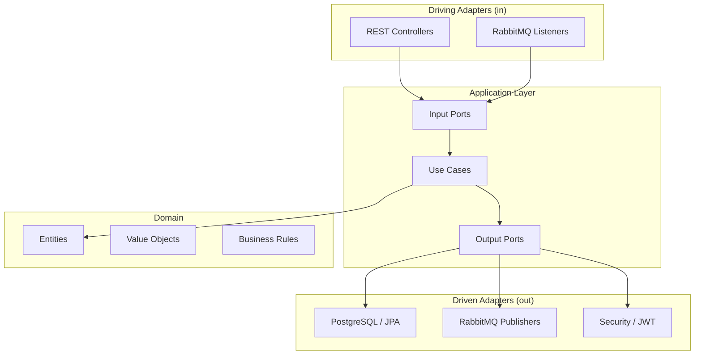

# NexBank — Digital Banking Platform

> **Educational Project — Does not handle real money**

A full-stack fintech demo platform built with Java 21 + Spring Boot 3, Angular 18, PostgreSQL 16, RabbitMQ, and Docker Compose — demonstrating production-grade patterns such as Hexagonal Architecture, JWT (RS256), the Transactional Outbox pattern, idempotency keys, and observability with Prometheus.

---

## Overview

NexBank simulates a digital bank with customer onboarding, account management, and financial transactions (deposits and transfers). The project exists purely for educational and portfolio purposes.

## Features

- Customer registration and authentication (JWT RS256)
- Account creation and management
- Deposits and peer-to-peer transfers
- Idempotency guarantees on all write operations
- Transactional Outbox pattern for reliable event publishing
- Optimistic locking on account balance updates
- Prometheus metrics and Spring Actuator health endpoints
- Flyway database migrations
- Full OpenAPI / Swagger documentation

## Tech Stack

| Layer | Technology |
|---|---|
| Backend | Java 21, Spring Boot 3.3.5 |
| Frontend | Angular 18, TypeScript |
| Database | PostgreSQL 16, Flyway |
| Messaging | RabbitMQ 3.13 |
| Security | Spring Security, OAuth2 Resource Server, JWT RS256 |
| Observability | Micrometer, Prometheus |
| API Docs | SpringDoc OpenAPI (Swagger UI) |
| Containerization | Docker, Docker Compose |
| CI | GitHub Actions |

## Architecture

The backend follows **Hexagonal Architecture (Ports and Adapters)**:

```
com.nexbank/
├── domain/           # Pure domain — no framework dependencies
│   ├── account/
│   ├── customer/
│   ├── transaction/
│   └── shared/
├── application/      # Use cases + port interfaces
│   ├── account/
│   ├── transaction/
│   ├── authentication/
│   └── notification/
└── adapters/         # Framework-specific implementations
    ├── in/           # Driving adapters (Web controllers, Messaging listeners)
    └── out/          # Driven adapters (Persistence, Messaging publishers, Security)
```

### Architecture Diagram



## Prerequisites

- Docker 24+ and Docker Compose v2
- Java 21 (for local development without Docker)
- Node 20 + npm (for local frontend development)
- OpenSSL (to generate RSA keys)

## Quick Start

```bash
# 1. Clone the repository
git clone https://github.com/your-org/nexbank.git
cd nexbank

# 2. Copy environment file and review values
cp .env.example .env

# 3. Generate RSA key pair for JWT
cd backend && ./scripts/generate-keys.sh && cd ..

# 4. Start all services
docker compose up -d

# 5. Check health
docker compose ps
```

## Environment Variables

See [`.env.example`](.env.example) for all available variables and their descriptions.

| Variable | Description | Default |
|---|---|---|
| `POSTGRES_DB` | Database name | `nexbank` |
| `POSTGRES_USER` | Database user | `nexbank_user` |
| `POSTGRES_PASSWORD` | Database password | — |
| `JWT_EXPIRATION_MS` | Access token TTL (ms) | `3600000` (1h) |
| `JWT_REFRESH_EXPIRATION_MS` | Refresh token TTL (ms) | `86400000` (24h) |
| `CORS_ALLOWED_ORIGINS` | Allowed CORS origins | `http://localhost:4200` |
| `RABBITMQ_USER` | RabbitMQ username | `nexbank_rabbit` |
| `RABBITMQ_PASSWORD` | RabbitMQ password | — |

## Running Tests

```bash
# Backend unit + integration tests
cd backend
mvn verify

# Frontend tests
cd frontend
npm test

# Frontend linting
cd frontend
npm run lint
```

## API Documentation

| Resource | URL |
|---|---|
| Swagger UI | http://localhost:8080/swagger-ui.html |
| OpenAPI JSON | http://localhost:8080/api-docs |
| Actuator Health | http://localhost:8080/actuator/health |

## Local URLs

| Service | URL |
|---|---|
| Backend API | http://localhost:8080 |
| Swagger UI | http://localhost:8080/swagger-ui.html |
| RabbitMQ Management | http://localhost:15672 |
| Prometheus | http://localhost:9090 |
| Frontend | http://localhost:4200 |

## Known Limitations

- This is an educational demo — **do not use in production**.
- No real payment gateway integration.
- RSA private key for JWT is stored locally; use Docker secrets or a vault in production.
- Rate limiting is not implemented in this phase.
- Frontend is a placeholder until Phase 4.

## License

MIT — see [LICENSE](LICENSE) for details.
