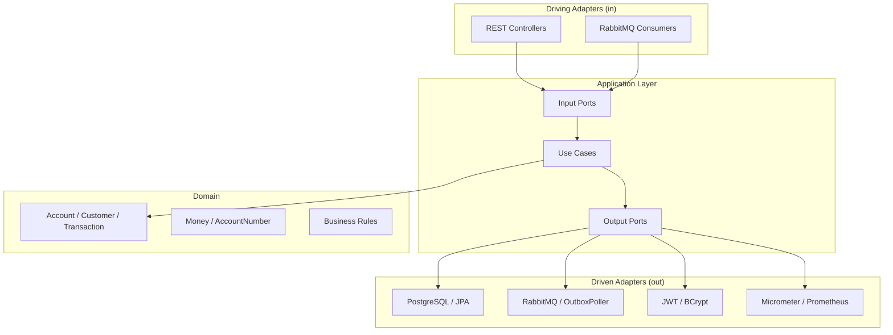

# NexBank — Digital Banking Platform

> **Educational Project — Does not handle real money**

<p align="center">
  <a href="README.md">🇺🇸 English</a> ·
  <a href="README.pt.md">🇧🇷 Português</a> ·
  <a href="README.fr.md">🇫🇷 Français</a>
</p>

---

<p align="center">

[](https://openjdk.org/projects/jdk/21/)
[](https://spring.io/projects/spring-boot)
[](https://angular.io/)
[](https://www.typescriptlang.org/)
[](https://www.postgresql.org/)
[](https://www.rabbitmq.com/)
[](https://docs.docker.com/compose/)
[](https://maven.apache.org/)
[](https://jwt.io/)
[](https://prometheus.io/)
[](https://flywaydb.org/)
[](https://www.jacoco.org/)
[](https://testcontainers.com/)
[](https://opensource.org/licenses/MIT)
[](https://github.com/leo12wb/Fintech-Api-Profissional/actions)

</p>

A full-stack fintech demo platform built with **Java 21 + Spring Boot 3**, **Angular 18**, **PostgreSQL 16**, **RabbitMQ**, and **Docker Compose** — demonstrating production-grade patterns: Hexagonal Architecture, JWT (RS256), Transactional Outbox, idempotency keys, Micrometer metrics, and Testcontainers-based integration testing.

---

## Features

- Customer registration and JWT authentication (RS256)
- Account creation and management (multi-currency ready)
- Deposits and peer-to-peer transfers with idempotency guarantees
- Optimistic locking on account balance updates (`@Version`)
- Transactional Outbox pattern — reliable event publishing to RabbitMQ
- Notification event consumers (TransactionCompleted, AccountCreated)
- Custom Prometheus metrics (`nexbank_transactions_total`, `nexbank_transaction_amount_cents`)
- Custom health indicator for outbox backlog (`/actuator/health/outbox`)
- Flyway database migrations
- Full OpenAPI / Swagger documentation
- Angular 18 frontend with Angular Material (lazy loading, guards, interceptors)
- Admin panel with separate layout, stats dashboard and customer management

## Tech Stack

| Layer | Technology |
|---|---|
| Backend | Java 21, Spring Boot 3.3.5, Maven |
| Frontend | Angular 18.2, TypeScript strict, Angular Material 18.2 |
| Database | PostgreSQL 16, Flyway, JPA / Hibernate |
| Messaging | RabbitMQ 3.13, Spring AMQP |
| Security | Spring Security, OAuth2 Resource Server, JWT RS256 |
| Observability | Micrometer, Prometheus, Spring Actuator |
| API Docs | SpringDoc OpenAPI (Swagger UI) |
| Testing | JUnit 5, Mockito, Testcontainers, ArchUnit, JaCoCo |
| Containerization | Docker, Docker Compose |
| CI | GitHub Actions |

## Architecture

The backend follows **Hexagonal Architecture (Ports and Adapters)**, enforced at build time by ArchUnit:

```
com.nexbank/
├── domain/            # Pure business logic — no Spring/JPA dependencies
│   ├── account/       #   Account, AccountNumber, Money, Currency
│   ├── customer/      #   Customer, enums
│   ├── transaction/   #   FinancialTransaction, enums
│   └── shared/        #   Money (value object), exceptions
├── application/       # Use cases + port interfaces
│   ├── account/       #   OpenAccount, GetAccount
│   ├── transaction/   #   Deposit, Transfer, GetStatement
│   ├── customer/      #   RegisterCustomer, GetCustomer
│   ├── authentication/#   TokenService port
│   └── shared/        #   OutboxEventRepository, MetricsPort
└── adapters/
    ├── in/
    │   ├── web/       #   REST controllers, DTOs, filters, exception handler
    │   └── messaging/ #   RabbitMQ consumers (NotificationConsumer)
    └── out/
        ├── persistence/  #  JPA entities, repositories, MapStruct mappers
        ├── messaging/    #  OutboxPoller (@Scheduled)
        ├── security/     #  JwtTokenService, BcryptPasswordEncoderAdapter
        ├── metrics/      #  MicrometerMetricsAdapter
        └── configuration/#  SecurityConfig, RabbitMqConfig, AppProperties, ...
```

### Architecture Diagram



### Transactional Outbox Flow

```
HTTP Request → Use Case → save(Transaction) + save(OutboxEvent[PENDING])  ← same DB tx
                                                        ↓
                                           OutboxPoller (@Scheduled 5s)
                                                        ↓
                                        RabbitMQ: nexbank.events exchange
                                                        ↓
                                          NotificationConsumer (log / notify)
```

## Prerequisites

- Docker 24+ and Docker Compose v2
- Java 21 (local development)
- Node 20 + npm (local frontend development)
- OpenSSL (to generate RSA keys)

## Development Credentials

> **For local use only — never use in production.**

| Profile | Login | Password | Role |
|---|---|---|---|
| Super Admin | `admin` | `Admin@123` | ADMIN |

The admin user is seeded directly into the database via SQL. Access the panel at `http://localhost:4200/admin`.

---

## Quick Start

```bash
# 1. Clone the repository
git clone https://github.com/leo12wb/Fintech-Api-Profissional.git
cd nexbank

# 2. Copy environment file and set secrets
cp .env.example .env
# Edit .env and set POSTGRES_PASSWORD, RABBITMQ_PASSWORD, and JWT secret values

# 3. Generate RSA key pair for JWT
cd backend/src/main/resources/certs
openssl genrsa -out private.pem 2048
openssl rsa -in private.pem -pubout -out public.pem
cd ../../../../../../

# 4. Start all services
docker compose up -d

# 5. Check health
docker compose ps
curl http://localhost:8080/actuator/health
```

## Local Development (without Docker)

```bash
# Start infrastructure only
docker compose up -d postgres rabbitmq

# Backend
cd backend
export SPRING_DATASOURCE_URL=jdbc:postgresql://localhost:5432/nexbank
export SPRING_DATASOURCE_USERNAME=nexbank_user
export SPRING_DATASOURCE_PASSWORD=nexbank_pass
mvn spring-boot:run

# Frontend (separate terminal)
cd frontend
npm install
npm start   # proxies /api → localhost:8080
```

## Running Tests

```bash
# Backend — all tests (unit + integration via Testcontainers)
cd backend
mvn verify

# Backend — unit tests only (no Docker required)
cd backend
mvn test -Dtest="!*IntegrationTest"

# Frontend — lint + build
cd frontend
npm run lint
npm run build -- --configuration production
```

## Environment Variables

See [`.env.example`](.env.example) for all variables.

| Variable | Description | Default |
|---|---|---|
| `POSTGRES_PASSWORD` | Database password | — (required) |
| `RABBITMQ_USER` | RabbitMQ username | `nexbank_rabbit` |
| `RABBITMQ_PASSWORD` | RabbitMQ password | — (required) |
| `JWT_EXPIRATION_MS` | Access token TTL | `3600000` (1 h) |
| `JWT_REFRESH_EXPIRATION_MS` | Refresh token TTL | `86400000` (24 h) |
| `CORS_ALLOWED_ORIGINS` | Allowed CORS origins | `http://localhost:4200` |
| `OUTBOX_POLL_INTERVAL_MS` | Outbox polling interval | `5000` (5 s) |

## API Endpoints

| Resource | Method | Path | Auth |
|---|---|---|---|
| Register | POST | `/api/v1/auth/register` | Public |
| Login | POST | `/api/v1/auth/login` | Public |
| Open account | POST | `/api/v1/accounts` | JWT |
| Get account | GET | `/api/v1/accounts/{id}` | JWT |
| Get balance | GET | `/api/v1/accounts/{id}/balance` | JWT |
| Deposit | POST | `/api/v1/transactions/deposits` | JWT + Idempotency-Key |
| Transfer | POST | `/api/v1/transactions/transfers` | JWT + Idempotency-Key |
| Statement | GET | `/api/v1/accounts/{id}/statement` | JWT |
| My profile | GET | `/api/v1/customers/me` | JWT |
| List customers | GET | `/api/v1/admin/customers` | JWT + ADMIN |
| Platform stats | GET | `/api/v1/admin/stats` | JWT + ADMIN |

## Observability Endpoints

| Resource | URL |
|---|---|
| Swagger UI | http://localhost:8080/swagger-ui.html |
| OpenAPI JSON | http://localhost:8080/api-docs |
| Actuator Health | http://localhost:8080/actuator/health |
| Outbox Health | http://localhost:8080/actuator/health/outbox |
| Prometheus Metrics | http://localhost:8080/actuator/prometheus |
| RabbitMQ Management | http://localhost:15672 |
| Prometheus | http://localhost:9090 |
| Frontend | http://localhost:4200 |
| Admin Panel | http://localhost:4200/admin |

### Custom Metrics

| Metric | Labels | Description |
|---|---|---|
| `nexbank_transactions_total` | `type=deposit\|transfer` | Count of completed transactions |
| `nexbank_transaction_amount_cents` | `type=deposit\|transfer` | Distribution of transaction amounts (cents) |

## License

MIT — see [LICENSE](LICENSE) for details.
