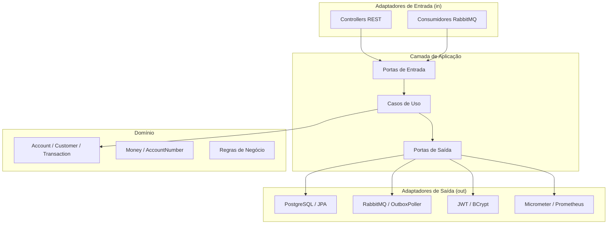

# NexBank — Plataforma de Banco Digital

> **Projeto Educacional — Não movimenta dinheiro real**

<p align="center">
  <a href="README.md">🇺🇸 English</a> ·
  <a href="README.pt.md">🇧🇷 Português</a> ·
  <a href="README.fr.md">🇫🇷 Français</a>
</p>

---

<p align="center">

[](https://openjdk.org/projects/jdk/21/)
[](https://spring.io/projects/spring-boot)
[](https://angular.io/)
[](https://www.typescriptlang.org/)
[](https://www.postgresql.org/)
[](https://www.rabbitmq.com/)
[](https://docs.docker.com/compose/)
[](https://maven.apache.org/)
[](https://jwt.io/)
[](https://prometheus.io/)
[](https://flywaydb.org/)
[](https://www.jacoco.org/)
[](https://testcontainers.com/)
[](https://opensource.org/licenses/MIT)
[](https://github.com/your-org/nexbank/actions)

</p>

Plataforma fintech full-stack construída com **Java 21 + Spring Boot 3**, **Angular 18**, **PostgreSQL 16**, **RabbitMQ** e **Docker Compose** — demonstrando padrões de nível produtivo: Arquitetura Hexagonal, JWT (RS256), Transactional Outbox, chaves de idempotência, métricas Micrometer e testes de integração com Testcontainers.

---

## Funcionalidades

- Cadastro de clientes e autenticação JWT (RS256)
- Criação e gerenciamento de contas (multi-moeda)
- Depósitos e transferências entre contas com garantias de idempotência
- Bloqueio otimista em atualizações de saldo (`@Version`)
- Padrão Transactional Outbox — publicação confiável de eventos no RabbitMQ
- Consumidores de eventos de notificação (TransactionCompleted, AccountCreated)
- Métricas Prometheus customizadas (`nexbank_transactions_total`, `nexbank_transaction_amount_cents`)
- Health indicator customizado para fila do outbox (`/actuator/health/outbox`)
- Migrações de banco com Flyway
- Documentação OpenAPI / Swagger completa
- Frontend Angular 18 com Angular Material (lazy loading, guards, interceptors)
- Painel administrativo com layout separado, dashboard de estatísticas e gestão de clientes

## Stack Tecnológica

| Camada | Tecnologia |
|---|---|
| Backend | Java 21, Spring Boot 3.3.5, Maven |
| Frontend | Angular 18.2, TypeScript strict, Angular Material 18.2 |
| Banco de Dados | PostgreSQL 16, Flyway, JPA / Hibernate |
| Mensageria | RabbitMQ 3.13, Spring AMQP |
| Segurança | Spring Security, OAuth2 Resource Server, JWT RS256 |
| Observabilidade | Micrometer, Prometheus, Spring Actuator |
| Documentação de API | SpringDoc OpenAPI (Swagger UI) |
| Testes | JUnit 5, Mockito, Testcontainers, ArchUnit, JaCoCo |
| Conteinerização | Docker, Docker Compose |
| CI | GitHub Actions |

## Arquitetura

O backend segue **Arquitetura Hexagonal (Ports and Adapters)**, validada em tempo de build pelo ArchUnit:

```
com.nexbank/
├── domain/            # Lógica de negócio pura — sem Spring/JPA
│   ├── account/       #   Account, AccountNumber, Money, Currency
│   ├── customer/      #   Customer, enums
│   ├── transaction/   #   FinancialTransaction, enums
│   └── shared/        #   Money (value object), exceções
├── application/       # Casos de uso + interfaces de portas
│   ├── account/       #   OpenAccount, GetAccount
│   ├── transaction/   #   Deposit, Transfer, GetStatement
│   ├── customer/      #   RegisterCustomer, GetCustomer
│   ├── authentication/#   Porta TokenService
│   └── shared/        #   OutboxEventRepository, MetricsPort
└── adapters/
    ├── in/
    │   ├── web/       #   Controllers REST, DTOs, filtros, exception handler
    │   └── messaging/ #   Consumidores RabbitMQ (NotificationConsumer)
    └── out/
        ├── persistence/  #  Entidades JPA, repositórios, mappers MapStruct
        ├── messaging/    #  OutboxPoller (@Scheduled)
        ├── security/     #  JwtTokenService, BcryptPasswordEncoderAdapter
        ├── metrics/      #  MicrometerMetricsAdapter
        └── configuration/#  SecurityConfig, RabbitMqConfig, AppProperties, ...
```

### Diagrama de Arquitetura



### Fluxo do Transactional Outbox

```
Requisição HTTP → Caso de Uso → save(Transaction) + save(OutboxEvent[PENDING])  ← mesma tx DB
                                                        ↓
                                           OutboxPoller (@Scheduled 5s)
                                                        ↓
                                        RabbitMQ: exchange nexbank.events
                                                        ↓
                                          NotificationConsumer (log / notificação)
```

## Pré-requisitos

- Docker 24+ e Docker Compose v2
- Java 21 (desenvolvimento local)
- Node 20 + npm (desenvolvimento frontend local)
- OpenSSL (para gerar chaves RSA)

## Credenciais de Desenvolvimento

> **Apenas para uso local — não use em produção.**

| Perfil | Login | Senha | Role |
|---|---|---|---|
| Super Admin | `admin` | `Admin@123` | ADMIN |

O admin é inserido diretamente no banco via seed SQL. Acesse o painel em `http://localhost:4200/admin`.

---

## Início Rápido

```bash
# 1. Clone o repositório
git clone https://github.com/your-org/nexbank.git
cd nexbank

# 2. Copie o arquivo de ambiente e configure os segredos
cp .env.example .env
# Edite .env e defina POSTGRES_PASSWORD, RABBITMQ_PASSWORD e valores JWT

# 3. Gere o par de chaves RSA para JWT
cd backend/src/main/resources/certs
openssl genrsa -out private.pem 2048
openssl rsa -in private.pem -pubout -out public.pem
cd ../../../../../../

# 4. Suba todos os serviços
docker compose up -d

# 5. Verifique a saúde
docker compose ps
curl http://localhost:8080/actuator/health
```

## Desenvolvimento Local (sem Docker)

```bash
# Suba apenas a infraestrutura
docker compose up -d postgres rabbitmq

# Backend
cd backend
export SPRING_DATASOURCE_URL=jdbc:postgresql://localhost:5432/nexbank
export SPRING_DATASOURCE_USERNAME=nexbank_user
export SPRING_DATASOURCE_PASSWORD=nexbank_pass
mvn spring-boot:run

# Frontend (terminal separado)
cd frontend
npm install
npm start   # proxy /api → localhost:8080
```

## Executando os Testes

```bash
# Backend — todos os testes (unitários + integração via Testcontainers)
cd backend
mvn verify

# Backend — somente testes unitários (sem Docker)
cd backend
mvn test -Dtest="!*IntegrationTest"

# Frontend — lint + build
cd frontend
npm run lint
npm run build -- --configuration production
```

## Variáveis de Ambiente

Consulte [`.env.example`](.env.example) para todas as variáveis.

| Variável | Descrição | Padrão |
|---|---|---|
| `POSTGRES_PASSWORD` | Senha do banco de dados | — (obrigatório) |
| `RABBITMQ_USER` | Usuário RabbitMQ | `nexbank_rabbit` |
| `RABBITMQ_PASSWORD` | Senha RabbitMQ | — (obrigatório) |
| `JWT_EXPIRATION_MS` | TTL do token de acesso | `3600000` (1 h) |
| `JWT_REFRESH_EXPIRATION_MS` | TTL do refresh token | `86400000` (24 h) |
| `CORS_ALLOWED_ORIGINS` | Origens CORS permitidas | `http://localhost:4200` |
| `OUTBOX_POLL_INTERVAL_MS` | Intervalo de polling do outbox | `5000` (5 s) |

## Endpoints da API

| Recurso | Método | Caminho | Auth |
|---|---|---|---|
| Registrar | POST | `/api/v1/auth/register` | Público |
| Login | POST | `/api/v1/auth/login` | Público |
| Abrir conta | POST | `/api/v1/accounts` | JWT |
| Buscar conta | GET | `/api/v1/accounts/{id}` | JWT |
| Saldo | GET | `/api/v1/accounts/{id}/balance` | JWT |
| Depósito | POST | `/api/v1/transactions/deposits` | JWT + Idempotency-Key |
| Transferência | POST | `/api/v1/transactions/transfers` | JWT + Idempotency-Key |
| Extrato | GET | `/api/v1/accounts/{id}/statement` | JWT |
| Meu perfil | GET | `/api/v1/customers/me` | JWT |
| Listar clientes | GET | `/api/v1/admin/customers` | JWT + ADMIN |
| Estatísticas | GET | `/api/v1/admin/stats` | JWT + ADMIN |

## Endpoints de Observabilidade

| Recurso | URL |
|---|---|
| Swagger UI | http://localhost:8080/swagger-ui.html |
| OpenAPI JSON | http://localhost:8080/api-docs |
| Actuator Health | http://localhost:8080/actuator/health |
| Outbox Health | http://localhost:8080/actuator/health/outbox |
| Métricas Prometheus | http://localhost:8080/actuator/prometheus |
| RabbitMQ Management | http://localhost:15672 |
| Prometheus | http://localhost:9090 |
| Frontend | http://localhost:4200 |
| Painel Admin | http://localhost:4200/admin |

### Métricas Customizadas

| Métrica | Labels | Descrição |
|---|---|---|
| `nexbank_transactions_total` | `type=deposit\|transfer` | Total de transações concluídas |
| `nexbank_transaction_amount_cents` | `type=deposit\|transfer` | Distribuição dos valores de transação (centavos) |

## Licença

MIT — veja [LICENSE](LICENSE) para detalhes.
